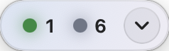
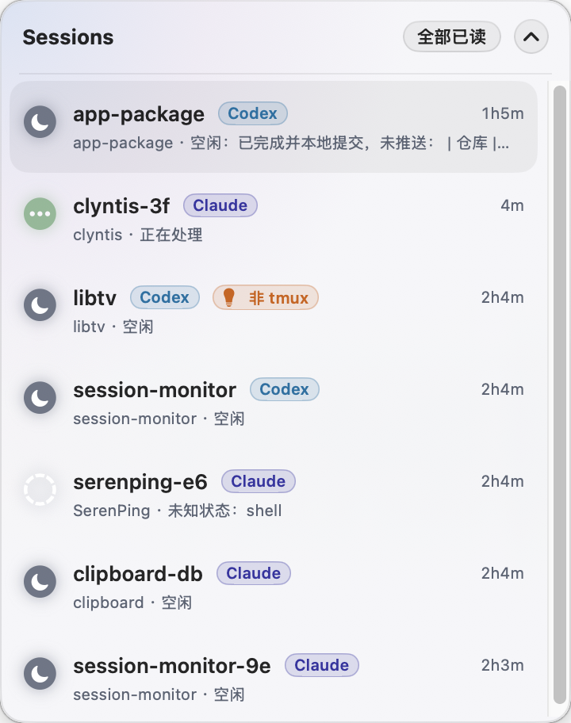
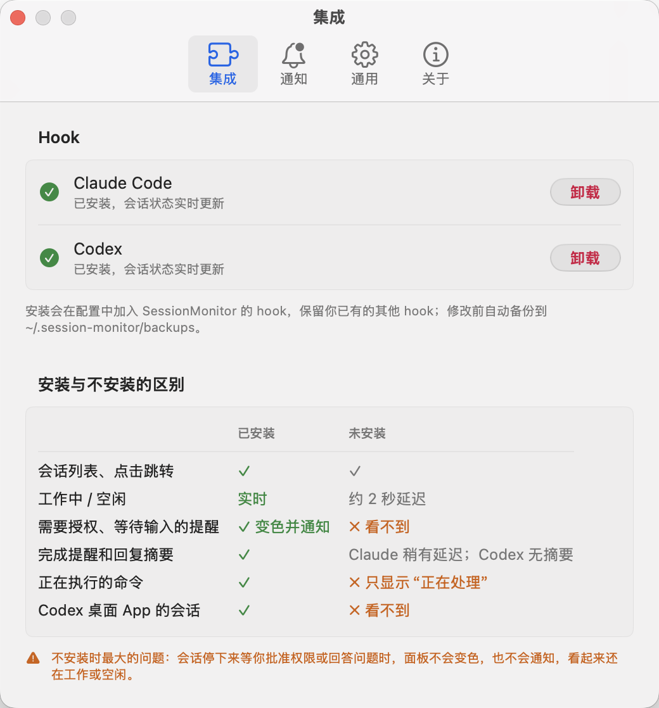

# 码哨 Codewhistle

## 使用说明

码哨（英文名 Codewhistle，原名 SessionMonitor）是运行在 Apple Silicon Mac（macOS 14 及以上）上的悬浮窗与菜单栏应用，用于查看 Claude Code 和 Codex 会话状态，并配有 iPhone App。App 名称随系统语言显示为"码哨"或"Codewhistle"；应用文件为 `Codewhistle.app`（访达只有在文件名与英文名一致时才会显示中文名"码哨"）。

<table>
  <tr>
    <th>收起</th>
    <th>展开</th>
    <th>设置</th>
  </tr>
  <tr>
    <td valign="top"></td>
    <td valign="top"></td>
    <td valign="top"></td>
  </tr>
</table>

### 安装与接入

1. 将 `Codewhistle.app` 放入 `/Applications`，然后启动。从旧版本升级时，先退出并删除原来的 `SessionMonitor.app`；配对、hook 和设置会保留。
2. 点击菜单栏图标 → **设置…** → **集成**，为需要监控的 Claude Code 或 Codex 点击 **安装**。
3. 使用 Codex 时，在 Codex 会话中输入 `/hooks`，批准码哨（sm-hook）的条目；安装后重启已打开的 Codex 会话。
4. 允许系统通知。需要调整权限时，打开 **系统设置 → 通知 → 码哨**。

安装 hook 会保留其他工具的配置，并在修改前备份到 `~/.session-monitor/backups/`。App 更新后会自动同步已安装的 hook 程序。

### 查看与操作会话

- 按 **⌥⌘S** 显示或隐藏悬浮窗；点击胶囊展开会话列表。
- 绿色表示工作中，蓝色表示完成未读，橙色表示需要授权，黄色表示等待输入，灰色表示空闲。
- 点击会话跳转到对应终端，并标记为已读；右键菜单可复制工作目录、复制会话 ID 或移除会话。
- 菜单栏提供全部已读、开机启动、设置、查看日志和退出。日志保存在 `~/.session-monitor/app.log`，只保留最近 3 天。
- 在设置中分别开启或关闭授权、输入和完成通知。

tmux 会话可定位到对应窗格；使用该功能需要安装 tmux。首次切换终端标签页时，按系统提示允许自动化权限。无法完成跳转时，应用会显示错误并复制会话工作目录。

### 手机访问

在 **设置… → 手机** 中开启"允许手机访问"，用码哨手机 App 扫描页面上的二维码完成配对。手机和 Mac 需要在同一局域网，或都连接 Tailscale。

- 手机上可以查看所有会话的状态和对话内容。
- tmux 中运行的会话还可以：查看终端画面、发送消息、按 Esc 中断、点选权限菜单的选项。终端正在显示选择菜单时，不能发送文字，以免回车误选默认项。
- 不在 tmux 中的会话只能查看。

只接受局域网和 Tailscale 地址的连接，通信经 TLS 加密，证书指纹在配对时固定；配对码 5 分钟内有效、只能使用一次。已配对的设备可在同一页面吊销。每次远程操作都会记录到日志。

### 卸载

在 **设置… → 集成** 中卸载相应 hook。

卸载 hook 会保留其他工具的配置与备份。移除应用前，先关闭开机启动、卸载 hook、退出应用，再删除 `Codewhistle.app`。

## 编译与打包说明

### 编译环境

- macOS 14 或以上版本。
- Xcode，包含 Swift 6、macOS SDK 和资源编译工具 `actool`。

以下命令均在项目根目录执行。

### 本地编译

```bash
scripts/build-app.sh
open build/Codewhistle.app
```

产物为 `build/Codewhistle.app`，包含应用和 `sm-hook`，默认使用 ad-hoc 签名。只构建 Apple Silicon（arm64）版本，需在 Apple Silicon Mac 上编译。

### iOS App

需要 [XcodeGen](https://github.com/yonaskolb/XcodeGen)（`brew install xcodegen`）。

```bash
cd ios && xcodegen generate
open SessionMonitorMobile.xcodeproj
```

在 Xcode 中选择模拟器或真机运行；装到真机需要在 target 的 Signing 中选择自己的开发团队。命令行测试客户端：`swift run sm-remote`（用法见 `Sources/sm-remote/main.swift`）。

### 发布打包

准备 Developer ID Application 签名证书，并将公证凭据保存到钥匙串。将示例占位符替换为自己的 Apple ID 和 Team ID：

```bash
xcrun notarytool store-credentials sessionmonitor-notary \
  --apple-id "YOUR_APPLE_ID" \
  --team-id "YOUR_TEAM_ID"
```

构建、签名、公证并生成 ZIP 和 DMG：

```bash
scripts/package-release.sh \
  --version 1.0.0 \
  --notary-profile sessionmonitor-notary
```

产物位于 `dist/`：

- `Codewhistle.app`
- `Codewhistle-1.0.0.zip`
- `Codewhistle-1.0.0.dmg`

脚本默认选择钥匙串中唯一的 Developer ID Application 证书；有多个证书时，用 `--identity "签名身份名称"` 指定。`--build` 设置构建号，`--no-dmg` 仅生成 ZIP。省略 `--notary-profile` 时只签名，不提交公证。

DMG 由 `scripts/make-dmg.sh` 生成：打开后是带背景和箭头的拖拽安装窗口，App 在左、Applications 在右。窗口布局由 Finder 写入，首次打包时需要允许终端控制 Finder。

### 发布到 GitHub

打包并公证后发布：

```bash
scripts/publish-release.sh 1.1.3
```

或者一步完成打包、公证和发布：

```bash
scripts/publish-release.sh 1.1.4 --build sessionmonitor-notary
```

脚本发布前会检查：工作区干净且已推送；`dist/` 里有对应版本的 DMG 和 zip；zip 里的 App 版本号正确；DMG 和 App 都已公证并能通过 Gatekeeper。任何一项不满足都会停止。检查通过后，给 HEAD 打 `v<版本>` 标签并推送，再创建 Release，上传 DMG 和 zip，附安装说明和 SHA-256。`--notes 文件` 用自定义说明，`--draft` 创建草稿。
